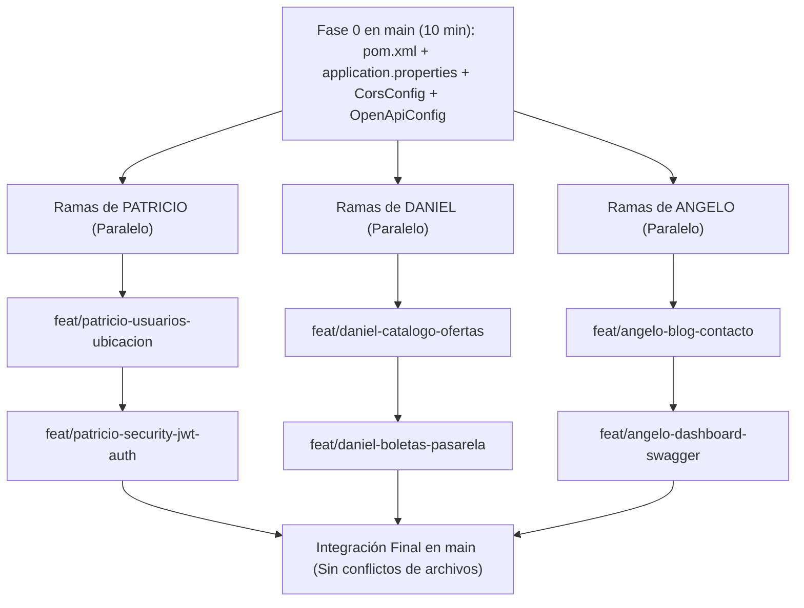

# Guía de Desarrollo Paralelo (No Secuencial) — Backend Spring Boot (`forte-piano-backend`)

- **Repositorio Backend:** `https://github.com/patricioisaias/forte-piano-backend`
- **Repositorio Frontend:** `https://github.com/lich73/forte-piano-react`
- **Asignatura:** Desarrollo Fullstack II (`DSY1104`) — Evaluación Parcial N° 3 (40%)
- **Equipo (3 Integrantes):**
  1. **Patricio Céspedes** — *Módulo A: Identidad, Usuarios, Geografía y Seguridad JWT*
  2. **Daniel Aedo** — *Módulo B: Catálogo, Ofertas, Checkout, Boletas y Pasarela de Pago*
  3. **Angelo Ponce** — *Módulo C: Blog, Contacto, Dashboard Estadístico, Swagger y QA*

> [!IMPORTANT]
> **¿Cómo usar este archivo en Antigravity?**
> Copien este archivo `plan-migracion-backend-springboot.md` dentro de la carpeta raíz (o `docs/`) del repositorio **`forte-piano-backend`**. Cada integrante puede abrir su propio chat de Antigravity en el proyecto backend y copiar el **Prompt para Antigravity** incluido en su sección correspondiente (Secciones 4, 5 y 6).

---

## 1. Arquitectura de Desarrollo 100% Paralelo (Sin Bloqueos ni Conflictos Git)

Para que **Patricio**, **Daniel** y **Angelo** puedan programar **al mismo tiempo (de manera no secuencial)** sin que uno tenga que esperar a que otro termine y sin pisarse archivos en Git, aplicamos tres reglas de desacoplamiento:

1. **Separación por Dominios Verticales (Zero Shared Files)**:
   - Cada integrante es dueño exclusivo de sus propias entidades, repositorios, DTOs, servicios y controladores.
   - **Ningún integrante edita archivos de otro integrante.**
2. **Semillas Independientes con `@Order` (`CommandLineRunner`)**:
   - En lugar de un solo archivo `DataSeeder.java` compartido (que causaría conflictos de merge), cada integrante crea su propio seeder independiente (`UsuariosSeeder.java`, `CatalogoBoletasSeeder.java`, `ContenidoSeeder.java`). Spring Boot detecta y ejecuta todos automáticamente al iniciar.
3. **Desacoplamiento entre `Usuario` y `Boleta` durante el desarrollo paralelo**:
   - En `Boleta.java` (Módulo de Daniel), el comprador se vincula mediante las columnas `clienteRun` (`usuario_run`), `clienteNombre` y `clienteCorreo`. Así Daniel puede compilar, probar y hacer merge de `Boleta` y `DetalleBoleta` **sin esperar** a que Patricio termine `Usuario.java` ni `SecurityConfig.java`.
   - En la Fase 0 (en `main`), el proyecto arranca con CORS abierto y sin bloqueo de seguridad hasta que Patricio integre su rama de Spring Security + JWT.



---

## 2. Mapa de Archivos por Integrante (Cero Conflictos de Merge)

Cada archivo del paquete base `cl.duoc.fortepiano` tiene un **único dueño**:

| Capa / Paquete | Base en `main` (Fase 0) | Patricio Céspedes (Módulo A) | Daniel Aedo (Módulo B) | Angelo Ponce (Módulo C) |
| :--- | :--- | :--- | :--- | :--- |
| **`config/`** | `CorsConfig.java`<br>`OpenApiConfig.java` | `UsuariosSeeder.java` (`@Order(1)`) | `CatalogoBoletasSeeder.java` (`@Order(2)`) | `ContenidoSeeder.java` (`@Order(3)`) |
| **`entity/`** | — | `Rol.java`<br>`Region.java`<br>`Comuna.java`<br>`Usuario.java` | `Categoria.java`<br>`Producto.java`<br>`Boleta.java`<br>`DetalleBoleta.java` | `Noticia.java`<br>`MensajeContacto.java` |
| **`repository/`** | — | `RolRepository.java`<br>`RegionRepository.java`<br>`ComunaRepository.java`<br>`UsuarioRepository.java` | `CategoriaRepository.java`<br>`ProductoRepository.java`<br>`BoletaRepository.java`<br>`DetalleBoletaRepository.java` | `NoticiaRepository.java`<br>`MensajeContactoRepository.java` |
| **`dto/`** | `ApiErrorDto.java` | `LoginRequest.java`<br>`RegistroRequest.java`<br>`ActualizarPerfilRequest.java`<br>`AuthResponse.java`<br>`SesionDto.java` | `CheckoutRequest.java`<br>`DatosEnvioDto.java`<br>`ItemCheckoutDto.java`<br>`ReintentoPagoRequest.java`<br>`BoletaResponseDto.java` | `DashboardResumenDto.java`<br>`MensajeContactoRequest.java` |
| **`security/`** | — | `JwtService.java`<br>`JwtAuthenticationFilter.java`<br>`CustomUserDetailsService.java`<br>`SecurityConfig.java` | — | — |
| **`service/`** | — | `RutValidatorService.java`<br>`UsuarioService.java`<br>`AuthService.java` | `CategoriaService.java`<br>`ProductoService.java`<br>`BoletaService.java` | `NoticiaService.java`<br>`ContactoService.java`<br>`DashboardService.java` |
| **`controller/`** | — | `UbicacionRolController.java`<br>`UsuarioController.java`<br>`AuthController.java` | `CategoriaController.java`<br>`ProductoController.java`<br>`BoletaController.java` | `NoticiaController.java`<br>`ContactoController.java`<br>`DashboardController.java` |
| **`src/test/...`** | — | `RutValidatorServiceTest.java`<br>`AuthServiceTest.java` | `ProductoServiceTest.java`<br>`BoletaServiceTest.java` | `NoticiaContactoServiceTest.java`<br>`DashboardServiceTest.java` |

---

## 3. Fase 0: Configuración Base en `main` (Antes de abrir las 3 ramas)

Uno de los integrantes (ej. Patricio, propietario del repo `https://github.com/patricioisaias/forte-piano-backend`) sube a `main` esta configuración base para que los 3 hagan `git clone` o `git pull origin main` y trabajen en paralelo.

### 3.1. Dependencias en `pom.xml`
Asegurarse de que `pom.xml` incluya:
- `spring-boot-starter-web`
- `spring-boot-starter-data-jpa`
- `spring-boot-starter-validation`
- `mysql-connector-j` (y `h2` con `<scope>test</scope>` para correr los tests sin requerir MySQL levantado)
- `projectlombok:lombok`
- `org.springdoc:springdoc-openapi-starter-webmvc-ui:2.6.0`
- `spring-boot-starter-security` *(o comentarla durante la Fase 0 si quieren probar endpoints sin token mientras Patricio desarrolla la rama `feat/patricio-security-jwt-auth`)*
- `io.jsonwebtoken:jjwt-api:0.12.6`, `jjwt-impl:0.12.6`, `jjwt-jackson:0.12.6`

### 3.2. `src/main/resources/application.properties`
```properties
spring.application.name=forte-piano-backend
server.port=8080

# Base de datos MySQL (crea fortepiano_db automáticamente si no existe)
spring.datasource.url=jdbc:mysql://localhost:3306/fortepiano_db?createDatabaseIfNotExist=true&useSSL=false&serverTimezone=America/Santiago&allowPublicKeyRetrieval=true
spring.datasource.username=root
spring.datasource.password=

# JPA / Hibernate
spring.jpa.hibernate.ddl-auto=update
spring.jpa.show-sql=true
spring.jpa.properties.hibernate.format_sql=true

# JWT
jwt.secret=FortePianoClaveSecretaSuperSeguraEvaluacion3DuocUC2026!
jwt.expiration-ms=86400000

# Swagger / OpenAPI 3
springdoc.api-docs.path=/v3/api-docs
springdoc.swagger-ui.path=/swagger-ui.html
springdoc.swagger-ui.operationsSorter=method
```

### 3.3. `CorsConfig.java` y `OpenApiConfig.java` en `config/`
```java
package cl.duoc.fortepiano.config;

import org.springframework.context.annotation.Bean;
import org.springframework.context.annotation.Configuration;
import org.springframework.web.cors.CorsConfiguration;
import org.springframework.web.cors.UrlBasedCorsConfigurationSource;
import org.springframework.web.filter.CorsFilter;
import java.util.List;

@Configuration
public class CorsConfig {
    @Bean
    public CorsFilter corsFilter() {
        CorsConfiguration config = new CorsConfiguration();
        config.setAllowCredentials(true);
        config.setAllowedOrigins(List.of("http://localhost:5173", "http://127.0.0.1:5173"));
        config.setAllowedHeaders(List.of("*"));
        config.setAllowedMethods(List.of("GET", "POST", "PUT", "PATCH", "DELETE", "OPTIONS"));

        UrlBasedCorsConfigurationSource source = new UrlBasedCorsConfigurationSource();
        source.registerCorsConfiguration("/**", config);
        return new CorsFilter(source);
    }
}
```

```java
package cl.duoc.fortepiano.config;

import io.swagger.v3.oas.models.Components;
import io.swagger.v3.oas.models.OpenAPI;
import io.swagger.v3.oas.models.info.Info;
import io.swagger.v3.oas.models.security.SecurityRequirement;
import io.swagger.v3.oas.models.security.SecurityScheme;
import org.springframework.context.annotation.Bean;
import org.springframework.context.annotation.Configuration;

@Configuration
public class OpenApiConfig {
    @Bean
    public OpenAPI customOpenAPI() {
        final String schemeName = "bearerAuth";
        return new OpenAPI()
            .info(new Info()
                .title("Forte & Piano - API REST E-Commerce Musical")
                .version("v1.0.0")
                .description("API REST en Spring Boot con JWT, Ofertas, Pasarela de Pago Simulada y Dashboard (DSY1104)."))
            .addSecurityItem(new SecurityRequirement().addList(schemeName))
            .components(new Components()
                .addSecuritySchemes(schemeName, new SecurityScheme()
                    .name(schemeName)
                    .type(SecurityScheme.Type.HTTP)
                    .scheme("bearer")
                    .bearerFormat("JWT")));
    }
}
```

---

## 4. Módulo Paralelo A — PATRICIO CÉSPEDES (Usuarios, Ubicación, Roles y Seguridad JWT)

Patricio desarrolla su trabajo en **2 ramas propias** sin tocar archivos de Productos, Boletas, Blog ni Dashboard.

### 4.1. Ramas y Commits de Patricio
1. **Rama 1: `feat/patricio-usuarios-ubicacion`**
   - Entidades:
     - `Rol.java` (`id`: Integer, `nombre`: String) -> `1=Administrador`, `2=Vendedor`, `3=Cliente`.
     - `Region.java` (`id`: Integer, `nombre`: String).
     - `Comuna.java` (`id`: Integer, `regionId`: Integer, `nombre`: String).
     - `Usuario.java` (`run`: String `@Id`, `nombre`, `apellidos`, `correo`, `password`, `fechaNacimiento`, `rolId`, `regionId`, `comunaId`, `direccion`, `estado`: `"Activo" | "Inactivo"`).
       - *Nota importante de compatibilidad con el Frontend*: Exponer `rolId` (`Integer`) directamente en el JSON de `Usuario` para que sea 100% compatible con `interface Usuario` de `forte-piano-react`.
   - Servicio `RutValidatorService.java`:
     - Implementar `limpiarRun(String run)`, `calcularDigitoVerificador(String cuerpo)` y `validarRun(String run)` con algoritmo **Módulo 11** idéntico al frontend (rechazando RUNs sin dígito verificador y verificando dominios `@duoc.cl`, `@profesor.duoc.cl`, `@gmail.com`).
   - Controladores REST:
     - `UbicacionRolController.java`:
       - `GET /api/v1/roles`
       - `GET /api/v1/regiones`
       - `GET /api/v1/comunas` (con filtro opcional `?regionId=`)
     - `UsuarioController.java`:
       - `GET /api/v1/usuarios`
       - `GET /api/v1/usuarios/{run}`
       - `POST /api/v1/usuarios` (valida RUN Módulo 11 y encripta password)
       - `PUT /api/v1/usuarios/{run}`
       - `DELETE /api/v1/usuarios/{run}`
   - Seeder `UsuariosSeeder.java` (`@Component @Order(1)`):
     - Inserta los 3 roles, 3 regiones, 7 comunas y los 4 usuarios semilla (`admin@gmail.com` / `admin123`, `vendedor@gmail.com` / `vend1234`, `camila@gmail.com` / `cliente1`, `diego@duoc.cl` / `diego123`).
2. **Rama 2: `feat/patricio-security-jwt-auth`**
   - `JwtService.java`, `JwtAuthenticationFilter.java`, `CustomUserDetailsService.java` y `SecurityConfig.java`.
   - `AuthController.java`:
     - `POST /api/v1/auth/login`: recibe `{ correo, password }` y devuelve `{ exito: true, token: "...", sesion: { run, nombre, apellidos, correo, rolId } }`.
     - `POST /api/v1/auth/registro`: crea un nuevo usuario con `rolId = 3` (Cliente), validando RUN Módulo 11.
     - `GET /api/v1/auth/me`: devuelve la `Sesion` actual a partir del token JWT (para persistencia ante recargas `F5`).
     - `PUT /api/v1/auth/perfil`: actualiza `{ nombre, apellidos, correo, regionId, comunaId, direccion }` del usuario autenticado (usado desde el Checkout).
   - Reglas en `SecurityConfig.java` según pauta oficial:
     - **Administrador (`ROLE_ADMIN`, `rolId = 1`)**: Acceso total.
     - **Vendedor (`ROLE_VENDEDOR`, `rolId = 2`)**: Acceso a lectura de productos (`GET /api/v1/productos/**`), lectura de órdenes (`GET /api/v1/boletas/**`) y resumen del dashboard (`GET /api/v1/dashboard/**`). Bloqueado en `/api/v1/usuarios/**`, creación/edición/eliminación de productos/categorías y anulación de boletas.
     - **Cliente (`ROLE_CLIENTE`, `rolId = 3`)**: Acceso a tienda pública, checkout (`POST /api/v1/boletas/checkout`), `/api/v1/boletas/mis-boletas` y edición de su propio perfil (`PUT /api/v1/auth/perfil`).

### 4.2. Prompt para el Chat de Antigravity de PATRICIO
> Copia y pega esto en tu chat de Antigravity dentro del repositorio `forte-piano-backend`:
>
> ```text
> Soy Patricio Céspedes (Módulo Paralelo A del proyecto forte-piano-backend).
> Lee el archivo plan-migracion-backend-springboot.md y desarrolla únicamente los archivos asignados a Patricio en la Sección 2 y Sección 4 (sin crear ni modificar archivos de Daniel ni de Angelo para evitar conflictos de merge):
> 1. Crea y cámbiate a la rama feat/patricio-usuarios-ubicacion.
> 2. Implementa las entidades Rol, Region, Comuna y Usuario (manteniendo los mismos nombres de campos JSON que el frontend React: run, nombre, apellidos, correo, password, fechaNacimiento, rolId, regionId, comunaId, direccion, estado), sus repositorios JPA, RutValidatorService (validación estricta Módulo 11 exigiendo dígito verificador y dominios @duoc.cl, @profesor.duoc.cl, @gmail.com), UsuarioService, UbicacionRolController (/api/v1/roles, /api/v1/regiones, /api/v1/comunas), UsuarioController (/api/v1/usuarios) y UsuariosSeeder (@Order(1)) con los datos semilla exactos. Haz commit en esta rama.
> 3. Crea la rama feat/patricio-security-jwt-auth desde feat/patricio-usuarios-ubicacion e implementa Spring Security con JWT (JwtService, JwtAuthenticationFilter, CustomUserDetailsService, SecurityConfig con permisos diferenciados para Administrador rolId=1, Vendedor rolId=2 y Cliente rolId=3) y AuthController (/api/v1/auth/login, /api/v1/auth/registro, /api/v1/auth/me, /api/v1/auth/perfil), además de pruebas unitarias JUnit 5 para RutValidatorService y AuthService.
> ```

---

## 5. Módulo Paralelo B — DANIEL AEDO (Catálogo, Ofertas, Checkout, Boletas y Pasarela Simulada)

Daniel desarrolla su trabajo en **2 ramas propias** en paralelo a Patricio y Angelo, sin depender de `Usuario.java` ni de `SecurityConfig.java`.

### 5.1. Ramas y Commits de Daniel
1. **Rama 1: `feat/daniel-catalogo-ofertas`**
   - Entidades:
     - `Categoria.java` (`id`: Integer, `nombre`: String).
     - `Producto.java` (`codigo`: String `@Id`, `nombre`, `descripcion`, `precio`, `stock`, `stockCritico`, `categoriaId`, `imagen`, `estado`: `"Activo" | "Inactivo"`, `enOferta`: Boolean, `porcentajeDescuento`: Integer, `precioOferta`: Integer).
       - *Relación en BD (Figura 1)*: incluir `@ManyToOne(fetch = FetchType.EAGER) @JoinColumn(name = "categoria_id", insertable = false, updatable = false) private Categoria categoria;` y mantener la columna `categoriaId` (`@Column(name = "categoria_id") private Integer categoriaId;`) para que la relación FK exista en MySQL tal como exige la Figura 1 y a la vez el JSON devuelva `categoriaId: 2` exactamente como espera React.
   - Servicios y Controladores:
     - `CategoriaService.java` y `CategoriaController.java` (`GET`, `POST`, `DELETE /api/v1/categorias`).
     - `ProductoService.java` y `ProductoController.java` (`GET`, `GET /{codigo}`, `POST`, `PUT /{codigo}`, `DELETE /{codigo}` en `/api/v1/productos`).
       - Si `enOferta == true` y se indica `porcentajeDescuento > 0` sin `precioOferta`, calcular automáticamente `precioOferta = Math.round(precio * (1 - porcentajeDescuento / 100.0f))`.
2. **Rama 2: `feat/daniel-boletas-pasarela`**
   - Entidades (`BOLETA` y `DETALLE_BOLETA` según Figura 1):
     - `Boleta.java`: `id` (`"BOL-..."`), `folio` (`Integer`), `fecha` (`String`), `clienteRun` (`@Column(name = "usuario_run")`), `clienteNombre`, `clienteCorreo`, `subtotalNeto`, `iva`, `total`, `metodoPago`, `estado` (`"Emitida" | "Pendiente" | "Rechazada" | "Anulada"`), `mensajeTransaccion`, datos de envío (`modalidad`, `destinatario`, `telefono`, `regionId`, `regionNombre`, `comunaId`, `comunaNombre`, `direccion`, `referencia`) y `@OneToMany(mappedBy = "boleta", cascade = CascadeType.ALL, orphanRemoval = true) private List<DetalleBoleta> items`.
     - `DetalleBoleta.java`: `id` (`Long`), `@ManyToOne Boleta boleta`, `codigo` (`@Column(name = "producto_codigo")`), `nombre`, `precioUnitario`, `cantidad`, `subtotal`.
   - Lógica de Pasarela de Pago Simulada en `BoletaService.java` (`@Transactional`):
     - `POST /api/v1/boletas/checkout`: recibe `CheckoutRequest` con `items`, `datosEnvio` y `resultadoTransaccion` (`"exitoso" | "rechazado" | "intentar_mas_tarde"`):
       - **`exitoso`**: verifica stock de cada producto, **descuenta el stock en BD**, calcula `subtotalNeto = Math.round(total / 1.19f)` e `iva = total - subtotalNeto`, y guarda la boleta con estado **`Emitida`**.
       - **`rechazado`**: no descuenta stock y guarda la boleta con estado **`Rechazada`**.
       - **`intentar_mas_tarde`**: no descuenta stock y guarda la boleta con estado **`Pendiente`**.
     - `PUT /api/v1/boletas/{id}/reintentar-pago`: recibe `{ resultadoTransaccion, metodoPago }`. Si la boleta estaba `Pendiente` o `Rechazada` y el nuevo resultado es `exitoso`, valida y descuenta el stock y pasa a `Emitida`.
     - `PUT /api/v1/boletas/{id}/anular`: cambia una boleta `Emitida` a `Anulada` y **repone el stock** de sus productos.
     - `GET /api/v1/boletas` y `GET /api/v1/boletas?clienteRun=...` (o `/api/v1/boletas/mis-boletas`).
   - Seeder `CatalogoBoletasSeeder.java` (`@Component @Order(2)`):
     - Inserta las 6 categorías iniciales, los 8 productos iniciales (con las ofertas en `AD-001`, `PD-001`, `SY-001`, `PD-002`) y las 5 boletas iniciales (`BOL-SEED-1001` a `BOL-SEED-1005`).

### 5.2. Prompt para el Chat de Antigravity de DANIEL
> Copia y pega esto en tu chat de Antigravity dentro del repositorio `forte-piano-backend`:
>
> ```text
> Soy Daniel Aedo (Módulo Paralelo B del proyecto forte-piano-backend).
> Lee el archivo plan-migracion-backend-springboot.md y desarrolla únicamente los archivos asignados a Daniel en la Sección 2 y Sección 5 (sin crear ni modificar archivos de Patricio ni de Angelo para evitar conflictos de merge):
> 1. Crea y cámbiate a la rama feat/daniel-catalogo-ofertas.
> 2. Implementa las entidades Categoria y Producto (con soporte de ofertas: enOferta, porcentajeDescuento, precioOferta y relación FK con Categoria manteniendo categoriaId en el JSON), sus repositorios, CategoriaService, ProductoService (con cálculo automático de precioOferta), CategoriaController (/api/v1/categorias) y ProductoController (/api/v1/productos). Haz commit en esta rama.
> 3. Crea la rama feat/daniel-boletas-pasarela desde feat/daniel-catalogo-ofertas e implementa las entidades Boleta y DetalleBoleta (incluyendo datosEnvio separados del perfil del cliente), BoletaService (@Transactional) con los 3 escenarios de la pasarela de pago simulada ('exitoso' -> estado 'Emitida' + descuento de stock, 'rechazado' -> estado 'Rechazada', 'intentar_mas_tarde' -> estado 'Pendiente'), reintento de pago (PUT /api/v1/boletas/{id}/reintentar-pago), anulación con reposición de stock (PUT /api/v1/boletas/{id}/anular), BoletaController (/api/v1/boletas), CatalogoBoletasSeeder (@Order(2)) con las 6 categorías, 8 productos y 5 boletas semilla, y pruebas unitarias JUnit 5 para ProductoService y BoletaService.
> ```

---

## 6. Módulo Paralelo C — ANGELO PONCE (Blog, Contacto, Dashboard Estadístico y Swagger)

Angelo desarrolla su trabajo en **2 ramas propias** en paralelo a Patricio y Daniel.

### 6.1. Ramas y Commits de Angelo
1. **Rama 1: `feat/angelo-blog-contacto`**
   - Entidades:
     - `Noticia.java` (`id`: Integer, `titulo`, `resumen`, `imagen`, `fecha`, `slug`, `@ElementCollection` o JSON `List<String> contenido`).
     - `MensajeContacto.java` (`id`: Long `@GeneratedValue`, `nombre`, `correo`, `comentario`, `fecha`).
   - Repositorios, Servicios y Controladores:
     - `NoticiaController.java`:
       - `GET /api/v1/noticias`
       - `GET /api/v1/noticias/{slug}`
     - `ContactoController.java`:
       - `GET /api/v1/contactos`
       - `POST /api/v1/contactos` (valida nombre, correo con dominio válido y comentario hasta 500 caracteres).
   - Seeder `ContenidoSeeder.java` (`@Component @Order(3)`):
     - Inserta las 3 noticias iniciales del blog (`detalle-1`, `detalle-2`, `detalle-3`) con sus párrafos completos.
2. **Rama 2: `feat/angelo-dashboard-swagger`**
   - `DashboardResumenDto.java`, `DashboardService.java` y `DashboardController.java` (`GET /api/v1/dashboard/resumen`):
     - Calcula y expone en un solo endpoint JSON todas las métricas para los gráficos estadísticos del Dashboard (`AdminDashboard.tsx` y `AdminReportes.tsx`):
       - `ventasTotales` (suma de boletas `Emitida`)
       - `cantidadPedidos` (total de boletas)
       - `unidadesVendidas`
       - `totalProductos`, `productosEnOferta`, `productosStockCritico`
       - `distribucionEstados` (conteo y porcentaje por estado: `Emitida`, `Pendiente`, `Rechazada`, `Anulada`)
       - `productosMasVendidos` (top 5 por unidades e ingresos)
       - `productosMayorStock` (top 6 con mayor stock disponible)
     - *Tip para desarrollo 100% paralelo*: Si la rama de Daniel aún no se ha unido a `main` cuando Angelo empieza su rama, `DashboardService` puede usar `JdbcTemplate` (consultando si existen las tablas `producto` y `boleta` con un fallback seguro) o unirse una vez que `feat/daniel-boletas-pasarela` esté lista, sin tocar ni un solo archivo de Daniel.
   - Documentación con anotaciones Swagger (`@Tag`, `@Operation`, `@ApiResponses`) y pruebas unitarias `NoticiaContactoServiceTest.java` y `DashboardServiceTest.java`.

### 6.2. Prompt para el Chat de Antigravity de ANGELO
> Copia y pega esto en tu chat de Antigravity dentro del repositorio `forte-piano-backend`:
>
> ```text
> Soy Angelo Ponce (Módulo Paralelo C del proyecto forte-piano-backend).
> Lee el archivo plan-migracion-backend-springboot.md y desarrolla únicamente los archivos asignados a Angelo en la Sección 2 y Sección 6 (sin crear ni modificar archivos de Patricio ni de Daniel para evitar conflictos de merge):
> 1. Crea y cámbiate a la rama feat/angelo-blog-contacto.
> 2. Implementa las entidades Noticia (con lista de párrafos en 'contenido') y MensajeContacto, sus repositorios JPA, NoticiaService, ContactoService, NoticiaController (/api/v1/noticias y /api/v1/noticias/{slug}), ContactoController (GET y POST /api/v1/contactos) y ContenidoSeeder (@Order(3)) con las 3 noticias iniciales del blog. Haz commit en esta rama.
> 3. Crea la rama feat/angelo-dashboard-swagger desde feat/angelo-blog-contacto e implementa DashboardResumenDto, DashboardService y DashboardController (GET /api/v1/dashboard/resumen) que entregue las métricas de ventas totales, cantidad de pedidos, distribución de pedidos por estado (Emitida, Pendiente, Rechazada, Anulada), productos más vendidos, productos con mayor stock y alertas de stock crítico, documentado con anotaciones @Tag y @Operation de Swagger/OpenAPI 3, además de pruebas unitarias JUnit 5 para NoticiaService, ContactoService y DashboardService.
> ```

---

## 7. Flujo de Integración de las 3 Ramas en `forte-piano-backend`

Como **no hay ningún archivo repetido** entre los 3 módulos (ver tabla de la Sección 2), el merge hacia `main` será automático y sin conflictos:

```bash
# 1. Patricio sube y hace merge de sus ramas:
git push -u origin feat/patricio-usuarios-ubicacion
git push -u origin feat/patricio-security-jwt-auth

# 2. Daniel sube y hace merge de sus ramas (en cualquier orden respecto a Patricio o Angelo):
git push -u origin feat/daniel-catalogo-ofertas
git push -u origin feat/daniel-boletas-pasarela

# 3. Angelo sube y hace merge de sus ramas:
git push -u origin feat/angelo-blog-contacto
git push -u origin feat/angelo-dashboard-swagger
```

Al levantar el proyecto integrado con `mvn spring-boot:run`:
1. `UsuariosSeeder` (`@Order(1)`), `CatalogoBoletasSeeder` (`@Order(2)`) y `ContenidoSeeder` (`@Order(3)`) poblarán automáticamente todas las tablas de `fortepiano_db`.
2. Swagger UI estará disponible en `http://localhost:8080/swagger-ui.html` con todos los endpoints bajo `/api/v1/...` y el botón **`Authorize` (Bearer JWT)**.
3. El frontend `forte-piano-react` (que ya cuenta con [`src/services/api.ts`](file:///c:/Users/patri/Desktop/FULLSTACK%20II/forte-piano-react/src/services/api.ts) y proxy en [`vite.config.ts`](file:///c:/Users/patri/Desktop/FULLSTACK%20II/forte-piano-react/vite.config.ts)) se conectará directamente a `http://localhost:8080/api/v1`.
